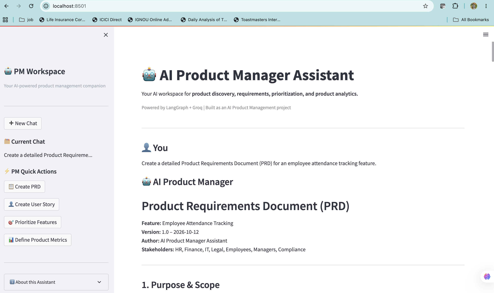
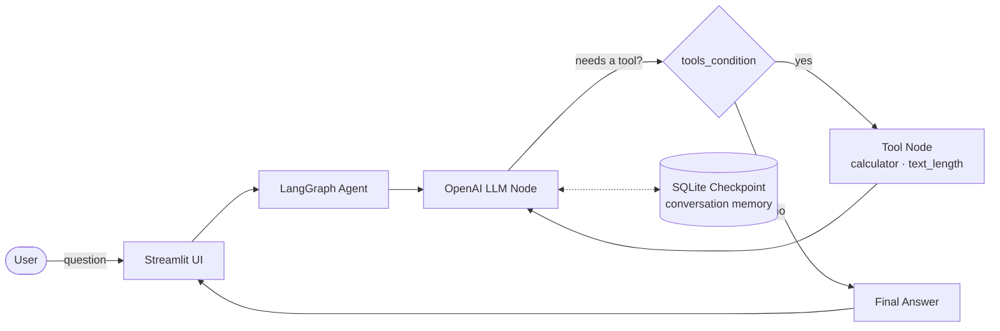

# 🤖 AI Product Manager Assistant

**A conversational, tool-using AI agent that drafts PRDs, user stories, prioritization frameworks, and product metrics — built on LangGraph, OpenAI, and Streamlit.**


---

## 📸 Preview



---

## 🎯 The Problem

Product Managers spend a disproportionate amount of time on repeatable, structured writing: PRDs, user stories with acceptance criteria, RICE scoring, and North Star / KPI definitions. These tasks are high-value but low-leverage — perfect candidates for agentic AI assistance that still keeps a human in the loop for judgment and context.

This project is a hands-on exploration of **agentic workflows for product management**: how to design an LLM-powered assistant that reasons about *when* to call a tool, remembers conversation context, and stays scoped to a specific professional domain rather than behaving as a generic chatbot.

## ✨ Key Features

| Feature | Description |
|---|---|
| 📋 **PRD Generation** | Drafts structured Product Requirement Documents from a short prompt. |
| 👤 **User Story Creation** | Produces user stories with Given-When-Then acceptance criteria. |
| 🎯 **Feature Prioritization** | Applies frameworks like RICE, with stated assumptions and scoring rationale. |
| 📊 **Product Metrics** | Defines North Star Metrics and supporting KPIs with formulas and reasoning. |
| 🔧 **Tool Calling** | The agent decides when to invoke a calculator or text-analysis tool mid-conversation. |
| 🧠 **Conversational Memory** | SQLite-backed LangGraph checkpointing persists multi-turn context per chat thread. |
| 🔍 **Tool Transparency** | Every tool call and its arguments are inspectable directly in the UI. |

## 🏗️ Architecture

The assistant is a small, explicit state graph rather than a single prompt — this keeps the reasoning loop debuggable and the tool boundary auditable.



**How a turn flows:**
1. The user submits a question through the Streamlit UI.
2. The LangGraph agent loads recent conversation history for that chat thread from SQLite.
3. The LLM node decides whether to answer directly or call a tool.
4. If a tool is needed, the tool node executes it and the result is routed back to the LLM for a final answer.
5. The response — plus a record of any tool calls — is returned to the UI and persisted for future turns.

## 🛠️ Tech Stack

- **Python 3.13**
- **LangGraph** — stateful agent orchestration and tool routing
- **LangChain** — LLM and tool abstractions
- **OpenAI** — language model (`gpt-4o-mini`)
- **Streamlit** — interactive chat UI
- **SQLite** — durable conversation checkpointing

## 📁 Project Structure

```text
AI-Product-Manager-Assistant/
├── app.py                 # Streamlit UI: chat, sidebar, quick actions
├── langgraph_agent.py      # Production agent graph used by the UI
├── tools.py                # Tool definitions (safe calculator, text length)
├── agent.py                # Minimal single-node LangGraph demo (CLI)
├── agent_with_tool.py      # Manual tool-calling demo without LangGraph
├── agents/
│   └── travel_agent.py     # Single-turn "explain simply" demo
├── requirements.txt
└── README.md
```

> The `agent.py`, `agent_with_tool.py`, and `agents/travel_agent.py` scripts are standalone learning exercises kept for reference — the live application only depends on `langgraph_agent.py` and `tools.py`.

## 🚀 Getting Started

### Prerequisites

- Python 3.11+
- An OpenAI API key
- Git

### 1. Clone the repository

```bash
git clone https://github.com/khileshwarpriya-design/AI-Product-Manager-Assistant.git
cd AI-Product-Manager-Assistant
```

### 2. Create and activate a virtual environment

```bash
python3 -m venv .venv
source .venv/bin/activate   # On Windows: .venv\Scripts\activate
```

### 3. Install dependencies

```bash
pip install -r requirements.txt
```

### 4. Configure your API key

Create a `.env` file in the project root:

```text
OPENAI_API_KEY=your_openai_api_key_here
```

Replace the placeholder with your own key. Never commit `.env` or publish API keys — it's already covered by `.gitignore`.

### 5. Run the application

```bash
streamlit run app.py
```

Open the local URL printed in your terminal (typically `http://localhost:8501`).

## 🔒 Security Notes

- The `calculator` tool parses expressions with Python's `ast` module and evaluates only a safe, explicit allow-list of arithmetic operators — it never calls `eval()` on untrusted input.
- API keys are loaded from a local `.env` file via `python-dotenv` and are never logged or hard-coded.

## 🗺️ Roadmap

- [ ] Evaluate response quality across representative PM tasks
- [ ] Add structured output validation (e.g., enforce PRD/user-story schemas)
- [ ] Add automated tests for the agent graph and tools
- [ ] Add user feedback capture and quality metrics
- [ ] Explore product analytics and evaluation dashboards
- [ ] Containerize for one-command deployment

## 💡 Product Management Perspective

This project sits at the intersection of product thinking and engineering execution: identifying a real workflow worth automating, designing the interaction model, orchestrating tools with explicit guardrails, managing conversational state, and defining how success would be measured if this went to production.

## ⚠️ Project Status

This is an evolving learning prototype, not a production-ready product. Outputs may require human review, and response quality, reliability, and business impact have not been formally validated at scale.

## 👤 Author

**Khileshwar Priya**

Product Management · Technical Product Management · AI Product Development

[View GitHub Repository](https://github.com/khileshwarpriya-design/AI-Product-Manager-Assistant)
